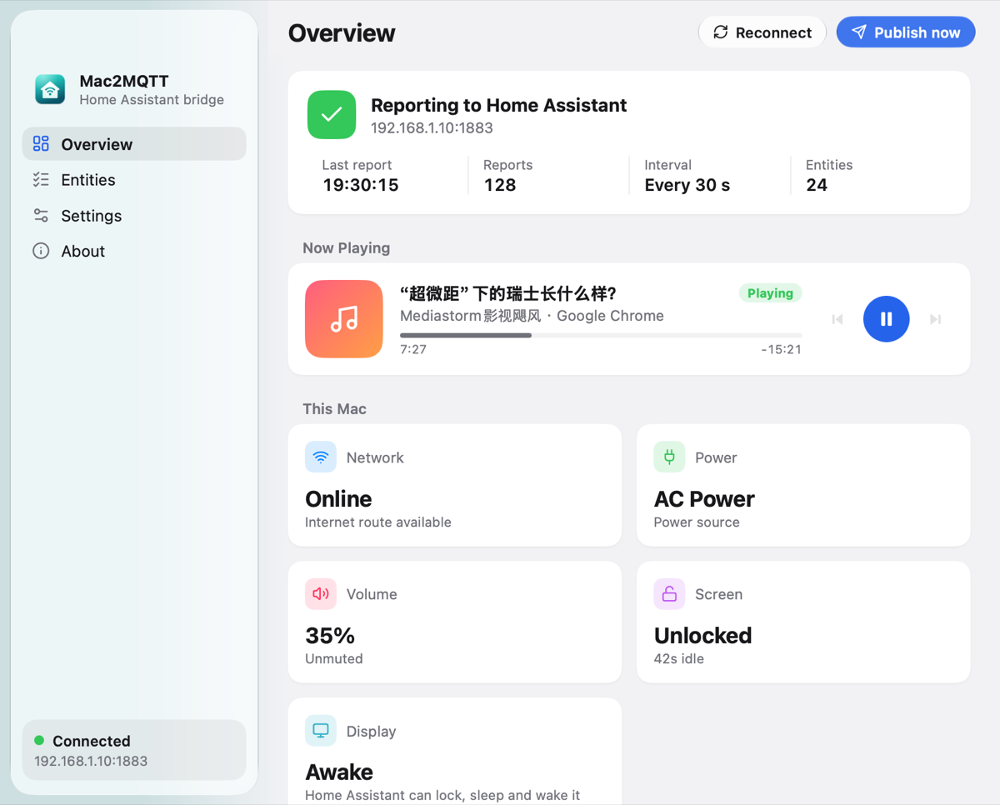
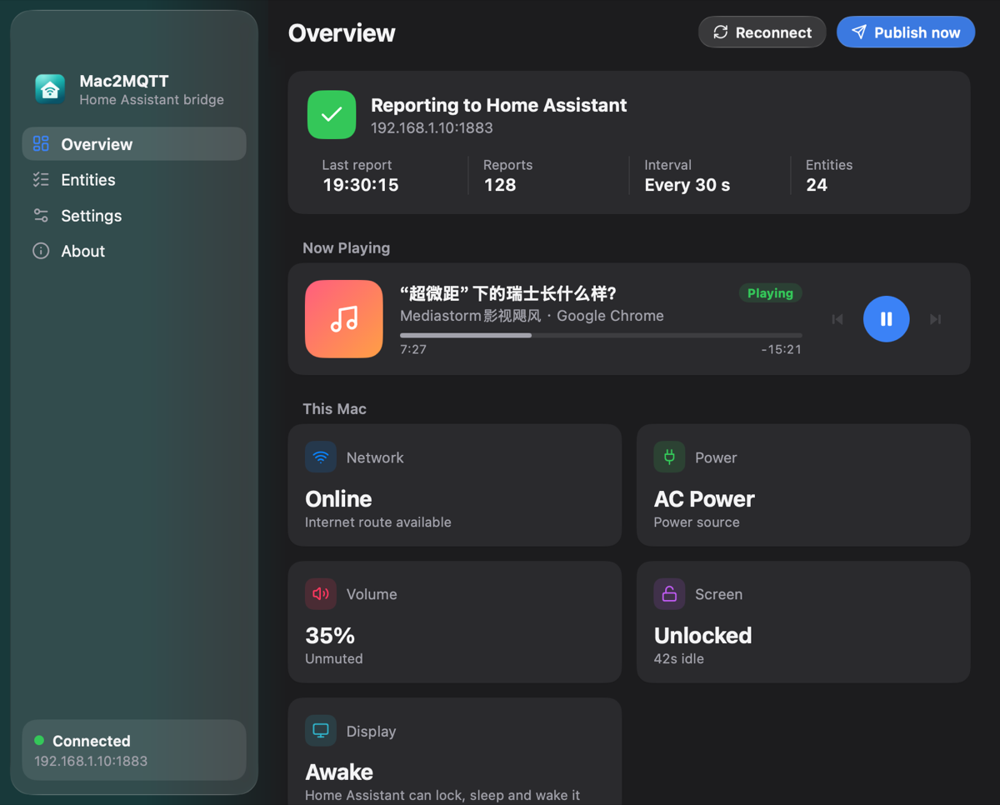
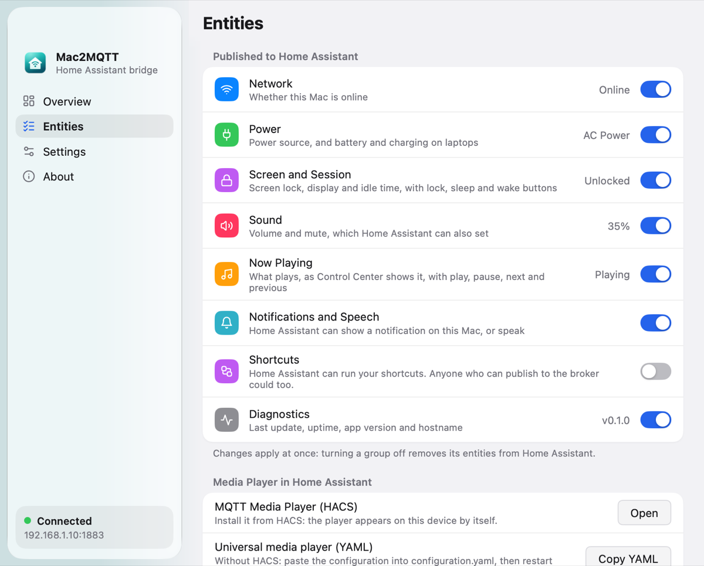
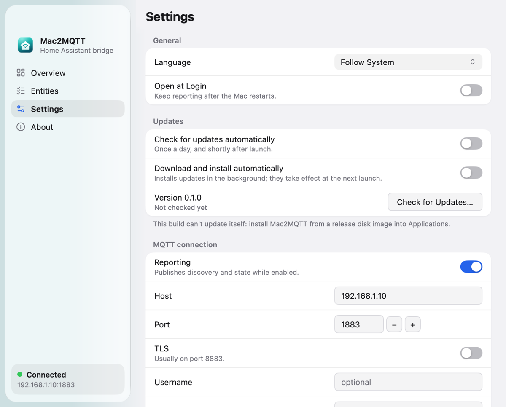

# Mac2MQTT

[](https://github.com/FaintGhost/mac2mqtt/actions/workflows/ci.yml)
[](https://github.com/FaintGhost/mac2mqtt/releases/latest)

**[faintghost.github.io/mac2mqtt](https://faintghost.github.io/mac2mqtt/)** · English | [简体中文](README.zh-CN.md)

A native macOS menu bar app that brings your Mac into Home Assistant over
MQTT: its network, power, screen and display, camera and microphone, sound
and what it is playing, with controls for playback, volume, the screen and
the display, notifications, speech and Shortcuts. Home Assistant creates the device and
its entities by itself through MQTT discovery.

<p align="center">
  
  
</p>

Built with [MyGo](https://github.com/egoist/mygo): native UI drawn by the app
itself, Liquid Glass included, in a single small binary with no webview.

## Features

- **Home Assistant discovery.** One device named after your Mac, with its
  model and macOS version, and entities you choose group by group.
- **Now Playing.** Whatever Control Center shows (Music, Spotify, a video in
  Safari or Chrome) with title, artist, app, progress and state, and buttons
  for play/pause, next and previous.
- **A real media player.** Home Assistant's MQTT integration has no
  `media_player`, so Mac2MQTT publishes one for the
  [MQTT Media Player](https://github.com/bkbilly/mqtt_media_player)
  integration, and generates a `universal` media player for those without
  HACS.
- **Sound.** Volume and mute, set from Home Assistant.
- **Screen and display.** Whether the screen is locked and the display
  awake, how long the Mac has been idle, and buttons to lock the screen,
  sleep or wake the display, and put the Mac to sleep.
- **Camera and microphone.** Whether an app uses them, as the menu bar's
  indicator shows, published within two seconds: turn on an on-air light
  during calls.
- **Notifications and speech.** Home Assistant can show a notification on
  the Mac, or have it speak.
- **Shortcuts.** Run any of your shortcuts from Home Assistant, with text as
  input (off until you turn it on).
- **Power and network.** Power source, battery and charging on laptops (a
  Mac mini or Mac Studio gets no battery entities), and connectivity.
- **Reliable MQTT.** Retained state, availability with a last will, and
  reconnecting with backoff. Turning a group off, or changing topics, clears
  what Home Assistant no longer should show.
- **A proper Mac app.** Lives in the menu bar, opens at login if you like,
  follows the system's light or dark appearance and language (English,
  简体中文, 繁體中文).

## Install

Download a disk image from the [latest release](https://github.com/FaintGhost/mac2mqtt/releases/latest):

| File | For |
|---|---|
| `Mac2MQTT-<version>-universal.dmg` | Any Mac |
| `Mac2MQTT-<version>-arm64.dmg` | Apple silicon (M1 and later) |
| `Mac2MQTT-<version>-amd64.dmg` | Intel |

Open it and drag Mac2MQTT to Applications. Requires macOS 13 or later.

The app is not notarized yet. The first time, macOS refuses to open it:
right-click it in Applications and choose **Open**, or allow it in **System
Settings → Privacy & Security**. Or clear the quarantine flag:

```sh
xattr -dr com.apple.quarantine /Applications/Mac2MQTT.app
```

## Set up

1. In Home Assistant, add the **MQTT** integration and leave discovery on
   (prefix `homeassistant`).
2. Open Mac2MQTT from the menu bar, go to **Settings**, enter your broker's
   host, port and credentials, and save.
3. The device appears in Home Assistant under **Settings → Devices &
   services → MQTT**.

Mac2MQTT updates itself from these releases: it checks in the background and
offers new versions with their notes, or installs them by itself if you let
it in **Settings → Updates**; **Check for Updates…** is in the menus.
Versions before 0.3.0 cannot update themselves: install 0.3.0 once by hand.

Turn on **Open at Login** in Settings to keep reporting after a restart. If
macOS asks, allow Mac2MQTT in **System Settings → General → Login Items**.

<p align="center">
  
  
</p>

## Entities

Each group can be turned off in **Entities**; its entities then leave Home
Assistant.

| Group | Entities |
|---|---|
| Network | Network Connectivity (binary sensor) |
| Power | Power Source; Battery and Charging on laptops |
| Screen and Session | Screen Locked, Display (binary sensors), Idle Time; Lock Screen, Sleep Display, Wake Display and Sleep buttons |
| Camera and Microphone | Camera In Use, Microphone In Use (binary sensors) |
| Sound | Volume (number), Mute (switch) |
| Now Playing | Media State, Now Playing (title, with artist, album, app and timing as attributes), Play/Pause, Next Track and Previous Track buttons, Media player |
| Notifications and Speech | Notification, Speak (`notify`) |
| Shortcuts (off by default) | Run Shortcut (select of your shortcuts) |
| Diagnostics | Last Update, App Uptime, App Version, Hostname |

A Refresh button, which publishes the state at once, is always there.

### Media player

Pick one:

- **With HACS:** install [MQTT Media Player](https://github.com/bkbilly/mqtt_media_player).
  The media player appears on the Mac's device by itself, with playback,
  progress, volume and mute.
- **Without HACS:** in **Entities → Media Player**, click **Copy YAML**,
  paste it into `configuration.yaml` and restart Home Assistant. It uses the
  built-in [universal media player](https://www.home-assistant.io/integrations/universal/).
  The YAML names the entities as Home Assistant does by default, such as
  `sensor.mac_mini_now_playing`: adjust them if you renamed yours.

## MQTT topics

With the default base topic `mac2mqtt/<device>`:

| Topic | Direction | Payload |
|---|---|---|
| `<base>/state` | Mac → broker | The state document (JSON, below) |
| `<base>/availability` | Mac → broker | `online` / `offline`, retained, last will |
| `<base>/media/state` | Mac → broker | `playing`, `paused` or `idle` |
| `<base>/media/attributes` | Mac → broker | Now Playing as JSON |
| `<base>/media/{title,artist,album,duration,position,volume,mute,mediatype}` | Mac → broker | One field each, for the media player |
| `<base>/volume/set` | HA → Mac | `0` to `100` |
| `<base>/mute/set` | HA → Mac | `ON` / `OFF` |
| `<base>/media/command` | HA → Mac | `PLAY`, `PAUSE`, `PLAY_PAUSE`, `STOP`, `NEXT`, `PREVIOUS` |
| `<base>/media/seek` | HA → Mac | Seconds from the start |
| `<base>/media/volume/set` | HA → Mac | `0` to `1` |
| `<base>/media/mute/set` | HA → Mac | `mute` / `unmute` |
| `<base>/system/command` | HA → Mac | `LOCK`, `DISPLAY_SLEEP`, `DISPLAY_WAKE`, `SLEEP` |
| `<base>/notify` | HA → Mac | Text, or `{"title": "…", "message": "…"}` |
| `<base>/say` | HA → Mac | Text to speak |
| `<base>/shortcut/run` | HA → Mac | A shortcut's name, or `{"name": "…", "input": "…"}` |
| `<base>/refresh` | HA → Mac | Anything: publish the state now |

Commands are taken only on the topics of groups that are on.

Discovery documents go to `<prefix>/<component>/<node-id>/<object-id>/config`.

<details>
<summary>The state document</summary>

```json
{
  "last_seen": "2026-10-25T16:20:00+08:00",
  "app": { "version": "0.1.0", "uptime_seconds": 42 },
  "device": {
    "hostname": "mac-mini.local",
    "os_version": "27.0.1",
    "arch": "arm64",
    "model": "Mac mini",
    "model_id": "Mac16,10"
  },
  "network": { "online": true, "metered": false },
  "power": { "on_battery": false, "source": "AC" },
  "session": { "locked": false, "idle_seconds": 12 },
  "activity": { "camera_in_use": false, "microphone_in_use": true },
  "display": { "awake": true },
  "audio": { "volume": 35, "muted": false },
  "media": {
    "state": "playing",
    "title": "Come Away With Me",
    "artist": "Norah Jones",
    "app_name": "Music",
    "duration_seconds": 198,
    "position_seconds": 42.5,
    "playback_rate": 1
  }
}
```

</details>

## Automation ideas

```yaml
# An on-air light while the Mac is in a call
automation:
  - alias: On air
    triggers:
      - trigger: state
        entity_id: binary_sensor.mac_mini_microphone_in_use
    actions:
      - action: "light.turn_{{ 'on' if trigger.to_state.state == 'on' else 'off' }}"
        target: { entity_id: light.door_sign }

  # Lock the Mac when everyone leaves
  - alias: Lock the Mac
    triggers:
      - trigger: state
        entity_id: zone.home
        to: "0"
    actions:
      - action: button.press
        target: { entity_id: button.mac_mini_lock_screen }

  # Tell the Mac when the laundry is done
  - alias: Laundry done
    triggers:
      - trigger: state
        entity_id: sensor.washer_status
        to: done
    actions:
      - action: notify.send_message
        target: { entity_id: notify.mac_mini_speak }
        data: { message: The laundry is done }
```

## Configuration

Settings live in `~/Library/Application Support/Mac2MQTT/config.json`, with
owner-only permissions. The broker password is stored there in plain text:
give Mac2MQTT a broker user of its own, limited to its topics.

| Setting | Meaning |
|---|---|
| Reporting | Connects and publishes while on |
| Host, Port, TLS | The broker; TLS usually on port 8883, verified with the system's trust store |
| Username, Password | Optional broker credentials |
| Discovery prefix | Usually `homeassistant` |
| Base topic | Root of the state and command topics |
| Device name | The device's name in Home Assistant |
| Interval | Seconds between reports, 5 to 3600 |
| Client ID | MQTT client and Home Assistant node ID (Advanced) |
| Retain state | Keeps the last state on the broker (Advanced) |

## How it works

- **Now Playing** comes from MediaRemote, the private framework behind
  Control Center. Since macOS 15.4 it only answers Apple-signed processes,
  so Mac2MQTT asks it through `osascript`, signed by Apple, with a short
  JavaScript for Automation script, for reading and for commands alike.
- **Screen lock** is read from the window server's session (`ioreg`) and
  kept current by lock and unlock notifications.
- **Camera, microphone and display** are read through CoreMediaIO, CoreAudio
  and CoreGraphics every two seconds, asking only whether a device is in
  use: nothing is recorded, and no permission is needed.
- **Volume and mute** use macOS's own audio settings.
- **Slow or flaky links** (a VPN relay with hundreds of milliseconds of round
  trip) are expected: messages go out in batches rather than one round trip
  each, discovery is published once and again only when it changes or Home
  Assistant restarts (the broker retains it), a report that fails is
  retried without dropping the connection, keepalive tolerates late pings,
  and waking or a network change reconnects at once.

```text
main.go, app.go, ui_*.go   the window, the menu bar and the settings (MyGo native UI)
internal/config            the configuration, validated and saved atomically
internal/broker            the MQTT client (paho) behind a small interface
internal/homeassistant     the discovery documents and the universal media player
internal/service           connecting, discovery, publishing and commands
internal/system            what the Mac reports, and its controls
locales/                   the catalogs (en, zh-Hans, zh-Hant) and their accessors
```

## Development

Requires Go 1.27.3 or later, on macOS.

```sh
go test ./...                 # unit tests: fake broker and commands, no real audio or media
go tool mygo dev              # run with live reload
go tool mygo build            # build/darwin-arm64/Mac2MQTT.app and a DMG
go tool mygo vet .            # MyGo's checks
go tool mygo i18n check       # the catalogs
```

After editing `locales/*.json`, run `go tool mygo generate` to update the
accessors. `MAC2MQTT_SNAPSHOTS=<dir> go test -run TestSnapshots .` renders
every page, light and dark, to PNGs.

### Releasing

Set `version` in `mygo.json`, commit, and push a matching tag:

```sh
git tag v0.2.0 && git push origin v0.2.0
```

Add the version's section to `CHANGELOG.md` first: it is the release's notes,
which the update window shows.

The release workflow checks that the tag and `mygo.json` agree, builds the
arm64, amd64 and universal disk images, signs the updates, and publishes
them with their SHA-256 checksums. Updates are signed with the secret key
that `go tool mygo keygen` made, kept in the repository's
`MYGO_UPDATER_PRIVATE_KEY` secret; installed apps check them against the
public key in `mygo.json`. Losing the secret key strands installed apps on
their version: keep a copy in a password manager.

## Limitations

- macOS 13 or later only.
- Signed ad hoc, not notarized (see [Install](#install)).
- MediaRemote is private: a future macOS may change it.
- Album artwork is not published: MediaRemote hands it only to an API
  `osascript` cannot call.
- TLS client certificates are not supported.

## Credits

Mac2MQTT stands on the work of others:

- **[MyGo](https://github.com/egoist/mygo)** by [@egoist](https://github.com/egoist),
  the framework the whole app is built with: its native UI toolkit and
  Liquid Glass draw every pixel of the window, with the menu bar, login
  item, notifications, localization and the build and packaging of the
  disk images, all in Go without cgo. A wonderful framework.
- [Eclipse Paho MQTT Go client](https://github.com/eclipse-paho/paho.mqtt.golang), the MQTT connection.
- [purego](https://github.com/ebitengine/purego) by Ebitengine, calling macOS's frameworks without cgo.
- [Lucide](https://lucide.dev), the icons (ISC license).
- [MQTT Media Player](https://github.com/bkbilly/mqtt_media_player) by bkbilly, whose discovery format gives Home Assistant a media player.
- [Home Assistant](https://www.home-assistant.io) and its MQTT discovery.

## License

[MIT](LICENSE)
