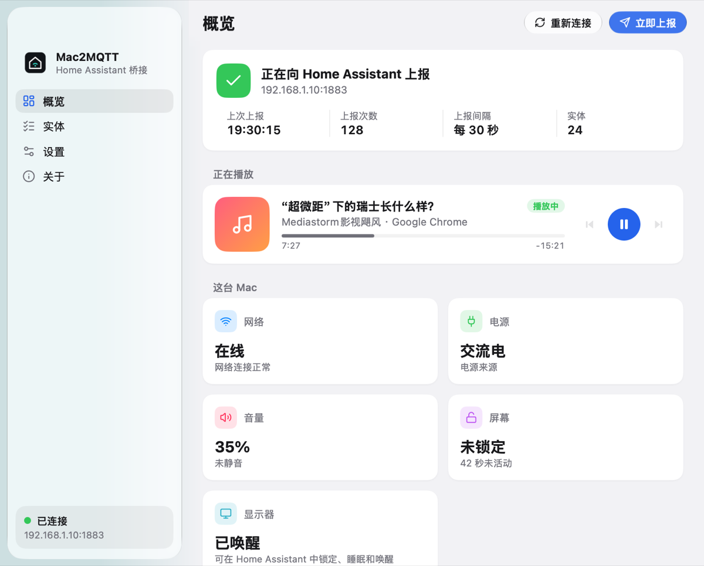
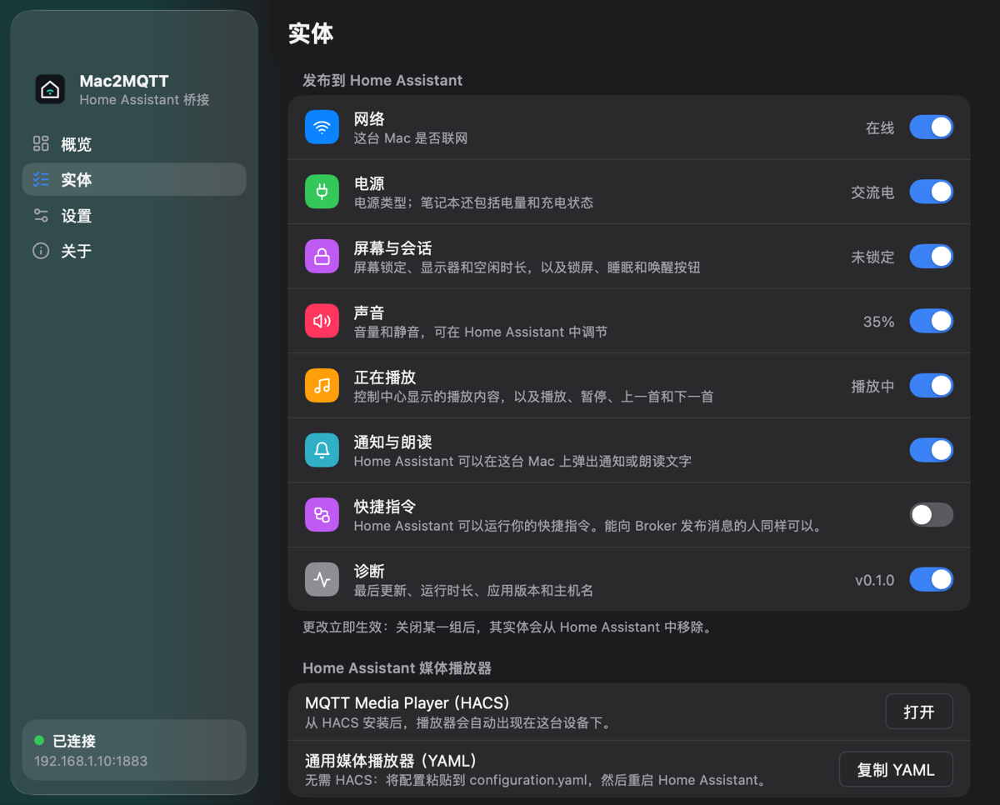

# Mac2MQTT

[](https://github.com/FaintGhost/mac2mqtt/actions/workflows/ci.yml)
[](https://github.com/FaintGhost/mac2mqtt/releases/latest)

**[faintghost.github.io/mac2mqtt](https://faintghost.github.io/mac2mqtt/?lang=zh)** · [English](README.md) | 简体中文

一个原生的 macOS 菜单栏应用，通过 MQTT 把你的 Mac 接入 Home Assistant：网络、
电源、锁屏、声音和正在播放的内容，并可在 HA 中控制音量、静音和播放。借助 MQTT
自动发现，Home Assistant 会自动创建设备和实体。

<p align="center">
  
  
</p>

基于 [MyGo](https://github.com/egoist/mygo) 构建：界面由应用自己绘制（包括
Liquid Glass），没有 WebView，只有一个小巧的二进制文件。

## 功能

- **Home Assistant 自动发现**：以你的 Mac 命名的设备，显示型号和 macOS 版本；
  实体按组自由选择是否发布。
- **正在播放**：控制中心里显示的一切（音乐、Spotify、Safari 或 Chrome 中的视频），
  包括标题、艺人、应用、进度和状态，并提供播放/暂停、上一首、下一首按钮。
- **真正的媒体播放器**：HA 的 MQTT 集成不支持 `media_player`，因此 Mac2MQTT 按
  [MQTT Media Player](https://github.com/bkbilly/mqtt_media_player) 集成的格式发布，
  并能为不使用 HACS 的用户生成 `universal` 媒体播放器配置。
- **声音**：在 HA 中设置音量和静音。
- **屏幕与显示器**：屏幕是否锁定、显示器是否唤醒、空闲时长；并提供锁屏、
  关闭/唤醒显示器、让 Mac 睡眠的按钮。
- **摄像头与麦克风**：是否有应用正在使用（与菜单栏指示灯一致），两秒内上报，
  可用来在通话时点亮“会议中”灯。
- **通知与朗读**：Home Assistant 可以在 Mac 上弹出通知或朗读文字。
- **快捷指令**：在 HA 中运行你的任意快捷指令，可附带文本输入（默认关闭，需手动开启）。
- **电源与网络**：电源类型；笔记本还有电量和充电状态（Mac mini、Mac Studio 不会创建电池实体）；联网状态。
- **可靠的 MQTT**：保留状态、带遗嘱的可用性、指数退避重连。关闭某组或修改 Topic 时，
  会清理 HA 中不该再显示的内容。
- **地道的 Mac 应用**：常驻菜单栏，可登录时打开，跟随系统的浅色/深色外观和语言
  （English、简体中文、繁體中文）。

## 安装

使用 [Homebrew](https://brew.sh)：

```sh
brew install --cask faintghost/tap/mac2mqtt
```

或从 [最新 Release](https://github.com/FaintGhost/mac2mqtt/releases/latest) 下载磁盘映像：

| 文件 | 适用于 |
|---|---|
| `Mac2MQTT-<版本>-universal.dmg` | 所有 Mac |
| `Mac2MQTT-<版本>-arm64.dmg` | Apple 芯片（M1 及以后） |
| `Mac2MQTT-<版本>-amd64.dmg` | Intel |

打开后把 Mac2MQTT 拖到“应用程序”。需要 macOS 13 或更高版本。

应用暂未经过公证，首次打开时 macOS 会阻止：在“应用程序”中右键点击它并选择
**打开**，或在 **系统设置 → 隐私与安全性** 中允许。也可以清除隔离标记：

```sh
xattr -dr com.apple.quarantine /Applications/Mac2MQTT.app
```

## 配置步骤

1. 在 Home Assistant 中添加 **MQTT** 集成，保持自动发现开启（前缀 `homeassistant`）。
2. 从菜单栏打开 Mac2MQTT，进入 **设置**，填写 Broker 的地址、端口和账号，保存。
3. 设备会出现在 HA 的 **设置 → 设备与服务 → MQTT** 中。

Mac2MQTT 会从 Release 自动更新：在后台检查新版本并显示更新说明，也可以在
**设置 → 更新** 中允许自动下载安装；菜单中有 **检查更新…**。0.3.0 之前的版本不支持自动更新，需要手动安装一次 0.3.0。

在设置中开启 **登录时打开**，重启后也会继续上报。如果 macOS 提示，请在
**系统设置 → 通用 → 登录项** 中允许 Mac2MQTT。

## 实体

每一组都可以在 **实体** 页关闭，关闭后其实体会从 HA 中移除。

| 组 | 实体 |
|---|---|
| 网络 | 网络连接（二元传感器） |
| 电源 | 电源类型；笔记本另有电量和充电状态 |
| 屏幕与会话 | 屏幕锁定、显示器（二元传感器）、空闲时长；锁屏、关闭显示器、唤醒显示器、睡眠按钮 |
| 摄像头与麦克风 | 摄像头使用中、麦克风使用中（二元传感器） |
| 声音 | 音量（数值）、静音（开关） |
| 正在播放 | 播放状态、正在播放（标题，艺人/专辑/应用/进度作为属性）、播放/暂停、下一首、上一首按钮、媒体播放器 |
| 通知与朗读 | 通知、朗读（`notify`） |
| 快捷指令（默认关闭） | 运行快捷指令（列出你的快捷指令的下拉选择） |
| 诊断 | 最后更新、运行时长、应用版本、主机名 |

另有一个始终发布的“刷新”按钮，用于立即上报状态。

### 媒体播放器

二选一：

- **使用 HACS**：安装 [MQTT Media Player](https://github.com/bkbilly/mqtt_media_player)，
  媒体播放器会自动出现在这台 Mac 的设备下，支持播放控制、进度、音量和静音。
- **不使用 HACS**：在 **实体 → Home Assistant 媒体播放器** 中点击 **复制 YAML**，
  粘贴到 `configuration.yaml` 后重启 HA。它使用 HA 自带的
  [universal 媒体播放器](https://www.home-assistant.io/integrations/universal/)。
  YAML 中的实体 ID 按 HA 默认规则生成（如 `sensor.mac_mini_now_playing`），如果你改过实体名，请相应修改。

## MQTT Topic

Topic 列表、状态文档格式、自动化示例和配置项说明见 [英文 README](README.md#mqtt-topics)。只有已开启的组才会接收对应 Topic 上的命令。

## 工作原理

- **正在播放** 来自 MediaRemote，即控制中心背后的私有框架。从 macOS 15.4 起它只响应
  Apple 签名的进程，因此 Mac2MQTT 通过 Apple 签名的 `osascript` 运行一小段
  JavaScript for Automation 脚本来读取信息和发送控制命令。
- **锁屏状态** 启动时从窗口服务器的会话信息（`ioreg`）读取，之后由锁屏/解锁通知更新。
- **音量和静音** 使用 macOS 自身的音频设置。
- **慢速或不稳定的网络**（例如往返数百毫秒的 VPN 中继）也能稳定工作：消息批量发送而非逐条等待确认；
  自动发现只在首次、内容变化或 Home Assistant 重启时发布（Broker 会保留它）；单次上报失败会重试而不断开连接；
  心跳容忍延迟；唤醒或网络变化时立即重连。
- **摄像头、麦克风和显示器** 每两秒通过 CoreMediaIO、CoreAudio 和 CoreGraphics
  读取一次，只询问设备是否被使用，不会录制任何内容，也不需要权限。

## 开发

需要 macOS 和 Go 1.27.3 或更高版本。

```sh
go test ./...                 # 单元测试：使用模拟的 Broker 和命令，不会改动真实音量或播放
go tool mygo dev              # 实时重载运行
go tool mygo build            # 生成 build/darwin-arm64/Mac2MQTT.app 和 DMG
go tool mygo vet .            # MyGo 的检查
go tool mygo i18n check       # 检查翻译目录
```

修改 `locales/*.json` 后运行 `go tool mygo generate` 更新访问函数。

### 发版

修改 `mygo.json` 中的 `version`，提交后推送同名 tag：

```sh
git tag v0.2.0 && git push origin v0.2.0
```

请先在 `CHANGELOG.md` 中写好该版本的内容，它会作为 Release 说明和更新窗口中的更新内容。

Release 工作流会检查 tag 与 `mygo.json` 是否一致，构建 arm64、amd64 和 universal
三种 DMG，签名更新包，并连同 SHA-256 校验和一起发布。更新包用 `go tool mygo keygen`
生成的私钥签名，私钥保存在仓库的 `MYGO_UPDATER_PRIVATE_KEY` Secret 中；已安装的应用用
`mygo.json` 里的公钥校验。私钥丢失后已安装的应用将无法再更新，请在密码管理器中备份。

## 限制

- 仅支持 macOS 13 及以上。
- 仅做了临时签名（ad hoc），未经公证（见 [安装](#安装)）。
- MediaRemote 是私有框架，未来的 macOS 可能会改变它。
- 暂不发布专辑封面：MediaRemote 只通过 `osascript` 无法调用的接口提供封面。
- 不支持 TLS 客户端证书。

## 致谢

Mac2MQTT 建立在这些优秀项目之上：

- **[MyGo](https://github.com/egoist/mygo)**（作者 [@egoist](https://github.com/egoist)）：整个应用所用的框架。
  它的原生 UI 工具包和 Liquid Glass 绘制了窗口里的每一个像素，还提供了菜单栏、
  登录项、通知、本地化以及 DMG 的构建打包，全部用 Go 实现、无需 cgo。非常棒的框架。
- [Eclipse Paho MQTT Go 客户端](https://github.com/eclipse-paho/paho.mqtt.golang)：MQTT 连接。
- [purego](https://github.com/ebitengine/purego)（Ebitengine）：无需 cgo 调用 macOS 框架。
- [Lucide](https://lucide.dev)：图标（ISC 许可证）。
- [MQTT Media Player](https://github.com/bkbilly/mqtt_media_player)（bkbilly）：其发现格式让 HA 拥有媒体播放器。
- [Home Assistant](https://www.home-assistant.io) 及其 MQTT 自动发现。

## 许可证

[MIT](LICENSE)
